# MorningBrief

> AI 起草 · 双人播报 · 每天早上听见世界


## 项目概述

一个把「新闻资讯 / 专业资料」自动转成**可订阅语音节目**的完整内容生产系统：
抓取 → AI 改写 → 语音合成 → 拼接混音 → 人工审核 → 定时发布，全链路内置，
并以单 exe 形式交付，单机零运维运行。

## 产品一览

每天 10 分钟，AI 生产的语音节目，打开微信小程序即听。

传统音频栏目要养一支队伍：选题、写稿、录音、剪辑、上线。MorningBrief 把这条链路做成
软件里可复用的流水线——运营者只需要提供素材来源和频道定位，系统每天自动产出成品节目，
人工只在「审核」这一道关口介入。

三点不同，来自它的设计取向：

- **节目化编排，而非单篇朗读**：一次产出是一期完整节目（开场白、分段讲述、片尾），不是把一篇文章念一遍。
- **全自动生产，可以日更**：抓取到发布由工作流调度驱动，各阶段状态可追踪、可重跑、断点续跑，无需人工录制。
- **小程序原生入口，免下载**：听众在微信里打开即听，锁屏继续播放、进度记忆、倍速播放都是内置能力。

### 关键数字速览

| 能力面 | 规模 |
| --- | --- |
| 内容生产工作流节点 | 7（抓取 / 改写 / 质检 / 合成 / 拼接 / 审核 / 发布） |
| 可插拔 TTS 引擎 | 5（阿里云 NLS / 腾讯云 / Edge-TTS / Kokoro / Piper） |
| 素材接入渠道 | 7（RSS、书籍 RSS 预制源、本地上传、云端存储导入、手动录入、API/URL 拉取、二维码分享） |
| 频道形态 | 3（新闻资讯 news / 课程学习 course / 有声读物 audiobook） |
| 广告投放位 | 3（开头 head / 中段 mid / 结尾 tail） |
| 运营后台模块 | 18 个一级模块、45 个页面组件 |
| 小程序页面 | 18 个 |
| 后端接口 | 43 个路由模块、243 个端点（按路由装饰器计数） |
| 数据模型 | 35 张业务表（SQLite WAL） |
| 质量保障 | pytest 全量回归 1694 个用例，另有前端单测、端到端用例、压测与静态扫描 |

> 表内数字按下列口径复核（2026-10-30）：后台一级模块 = `src/views/` 子目录数（18），
> 页面组件 = `src/views/**/*.vue`（45），路由模块 = `app/routers/**/*.py`（43），
> 业务表 = `__tablename__` 声明数（35），小程序页面 = `app.json` 的 `pages` + `subPackages`（18），
> 端点 = 路由装饰器计数（243）；pytest 用例数沿用 `docs/产品介绍/verify_docx.py` 的同一口径，
> 与「测试」章节保持一致。素材渠道、投放位、工作流节点口径与需求规格说明书一致。

## 核心功能与界面

以下界面截图取自本机隔离实例的真实页面：后端跑仓库当前代码，数据库为生产库快照副本，
登录口令为该副本随机生成，未连生产服务；画面中的密钥字段本身即为脱敏显示，未虚构任何数据。
图片随源码入库在 `docs/assets/product-intro/`（18 张）。
产品介绍文档里另有两张图没有搬进来——素材库列表页与一期未过审稿件的全文，
原因写在对应小节下方，一句话版：那两块画面属于第三方内容与待人工拦截的 AI 稿，不适合放公开仓库首页。

### 1. 全自动内容工作流

七道工序串成一条可观测的流水线：抓取入库、AI 改写、内容质检、语音合成、音频拼接、人工审核、定时发布。每个节点独立记录状态与产物，失败可以只重跑那一段；队列支持排队、并发控制与长任务后台化。

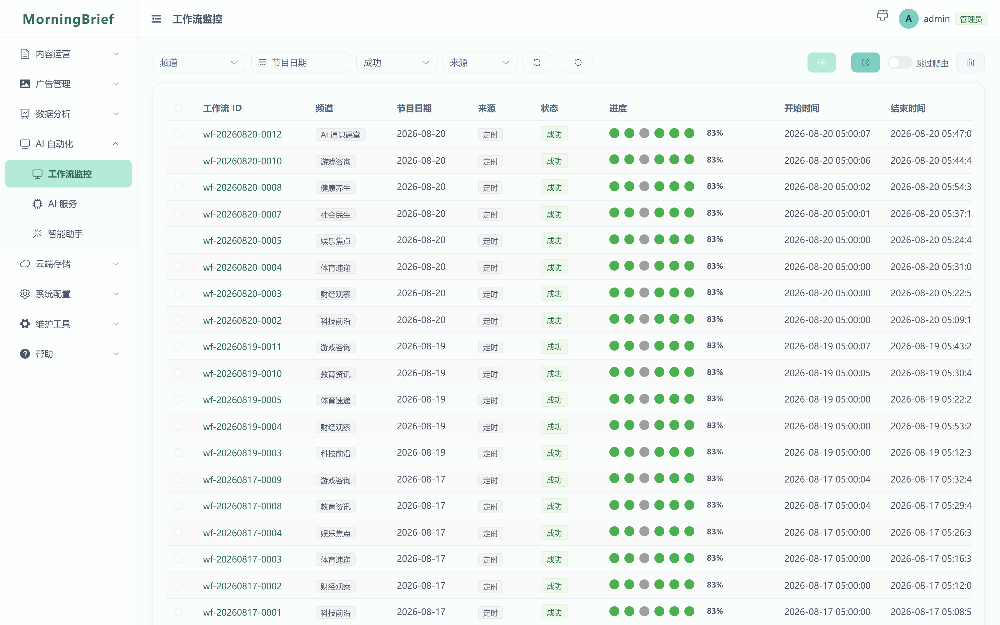

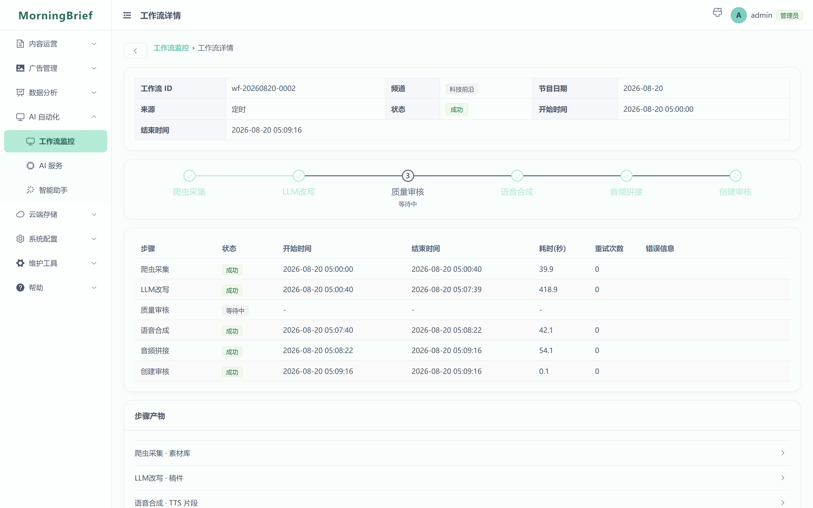

### 2. 素材从哪来：七类接入渠道

通用资讯走 RSS 与 API/URL 拉取；有声读物与课程走书籍 RSS 预制源、EPUB/整本文件上传（单事务入库、断点续传）与云端存储（COS）导入；也保留手动录入与二维码/链接分享，便于线下资料一次性进场。

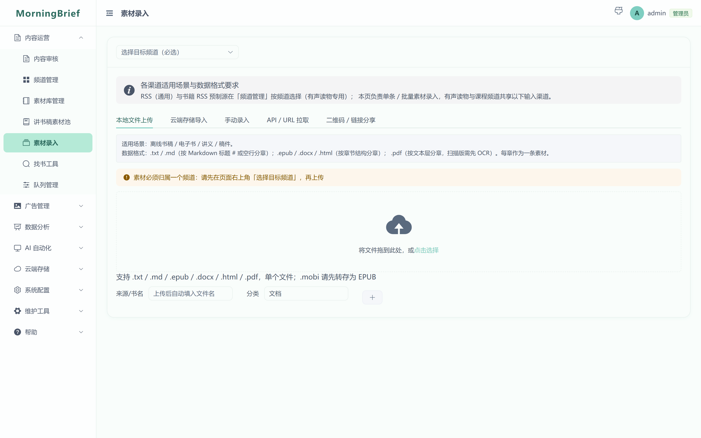

> 素材库列表页的截图改由「素材录入」代表：列表画面里是各来源站当天的真实标题，
> 放到公开仓库首页等于替第三方站点转载内容，需要出图请改用示例数据（见工单说明）。

### 3. AI 改写与内容质检

改写模板按频道独立配置，同一套流水线可以产出「新闻主播口吻」与「讲书人口吻」两种完全不同的节目。质检节点在合成前把关：字数与结构校验、敏感词与内容安全检测，未过线的稿件不会变成音频。

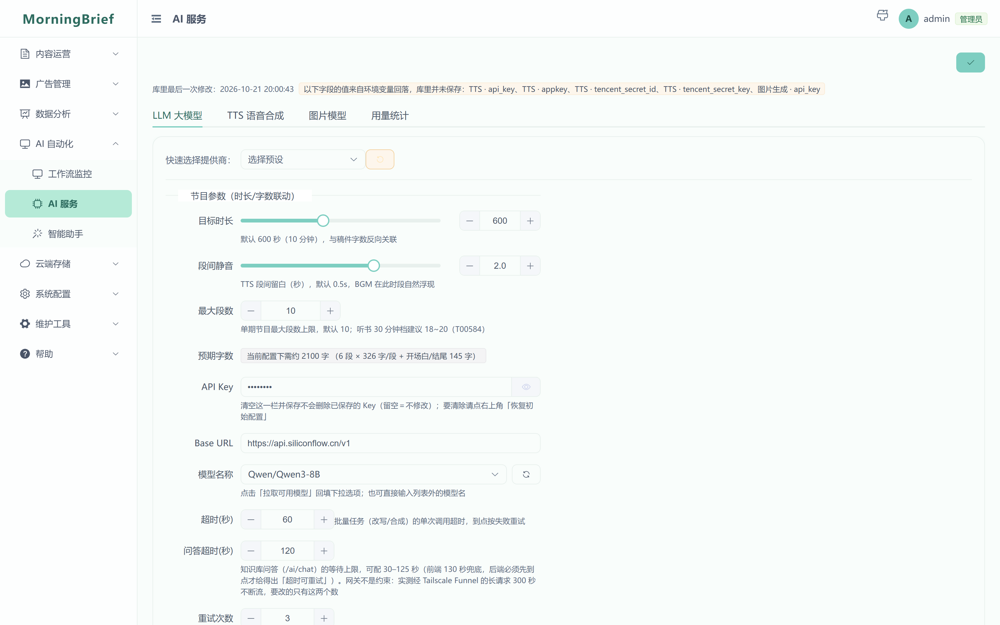

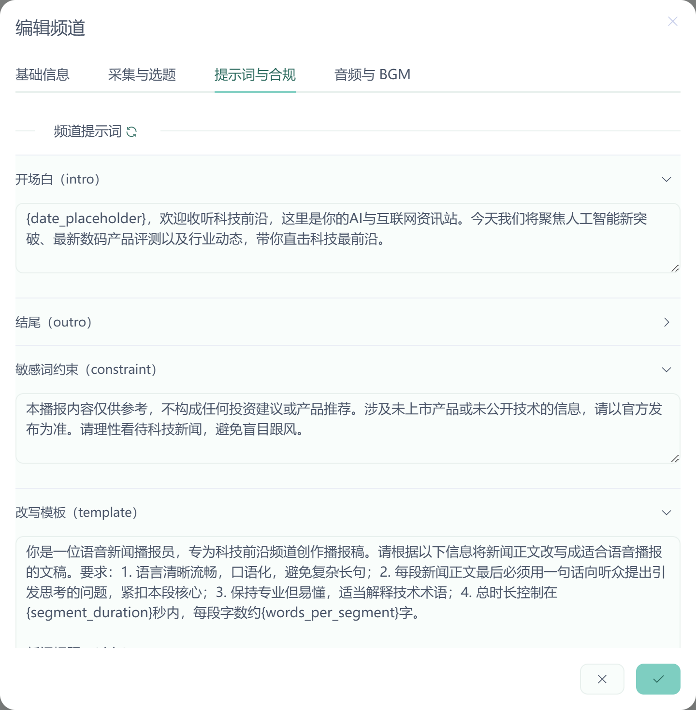

### 4. 五个 TTS 引擎与交叉音色

阿里云 NLS、腾讯云、Edge-TTS（免费）、Kokoro、Piper（本地离线）统一在同一个 Provider 抽象下，随时切换、互为备份，音色清单支持一键从官方接口同步。支持分段轮流换声（轮流 / 随机 / 间隔三种策略），双人播报的听感就来自这里。

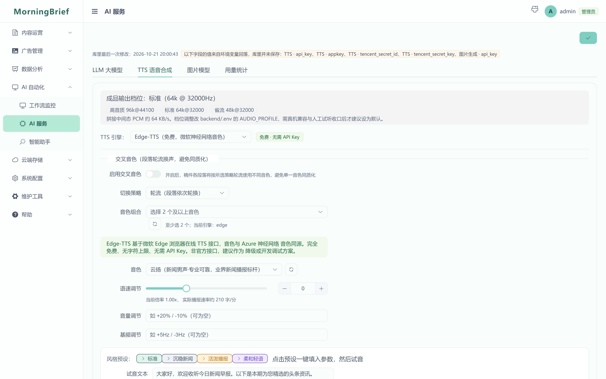

### 5. 音频拼接与三段式广告

分段音频拼成整期节目，支持片头片尾与背景音乐混音。广告投放按开头、中段、结尾三个位置排期，可按日期区间生效与停用，运营者能在后台看到每条规则的当前投放状态。

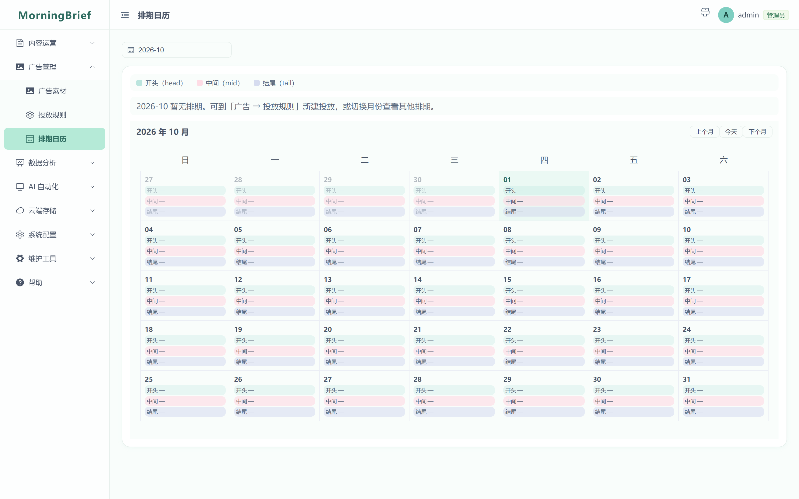

### 6. 审核：人始终在最后一步

审核列表支持按状态、审核人、日期、频道筛选；自动审批可以为指定频道减轻逐条点按的负担，同时对高风险项保留确认护栏，并在配置页顶部点名仍未确认的存量项。所有审核动作进入审计日志。

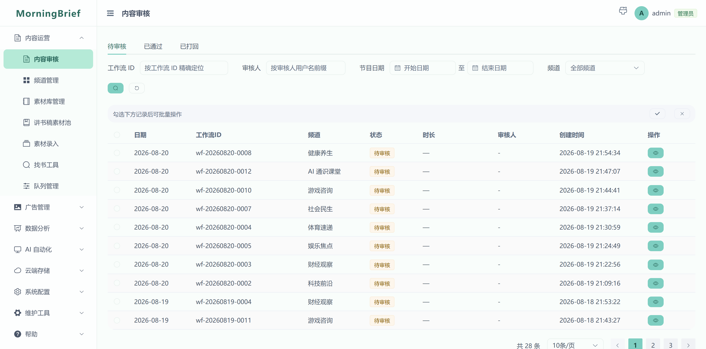

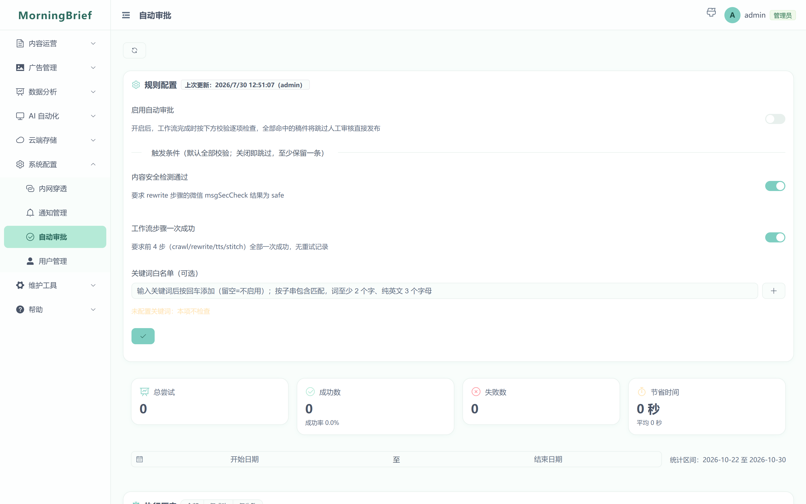

> 「审核详情——AI 改写后的稿件全文」那张图这里不放：画面是一期**尚未过审**的真实稿件全文，
> 里面是被改写的第三方资讯内容，且 AI 稿本身可能含事实性错误——正是要靠审核拦下来的东西，
> 不适合放进公开仓库首页当展示。

### 7. 多频道：一套系统养多个栏目

新闻早报、每日听书、课程学习三种频道形态共用同一条流水线，听众端按频道类型自动切换交互与皮肤（课程走章节列表）。栏目之间互不干扰，可以分别配置素材源、改写模板、音色与发布节奏。

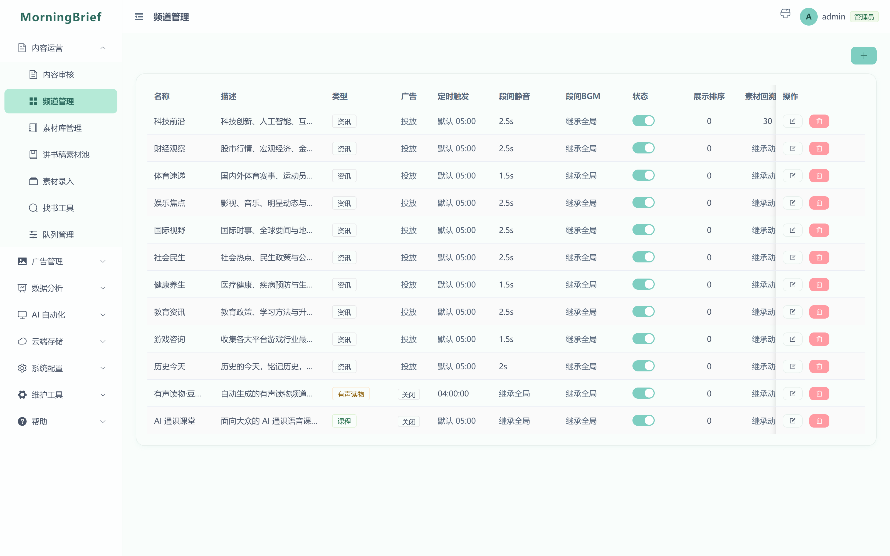

### 8. 运营数据与消息中心

收听统计按指标登记单位与口径，趋势、漏斗、完播等视图直接读生产数据；通知模板与投递日志记录每一次触达，站内收件箱保留事件并提供跳转到对应处理页面的深链。

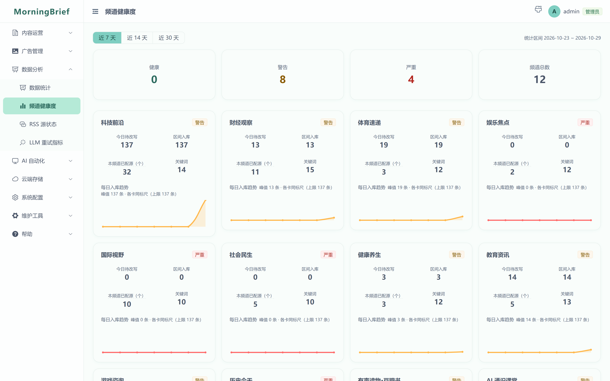

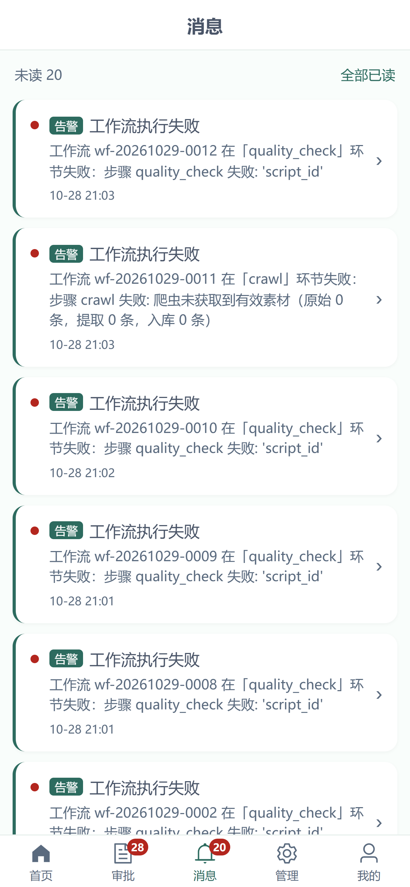

### 9. 单机交付与运维能力

一个安装包带走全部依赖：SQLite（WAL）与进程内缓存替代 MySQL/Redis，单 worker 即可稳定运行。运维侧配套数据库维护、备份与快照恢复、参数化清理、应急停服与恢复、健康检查，敏感值默认脱敏显示并留审计痕迹。

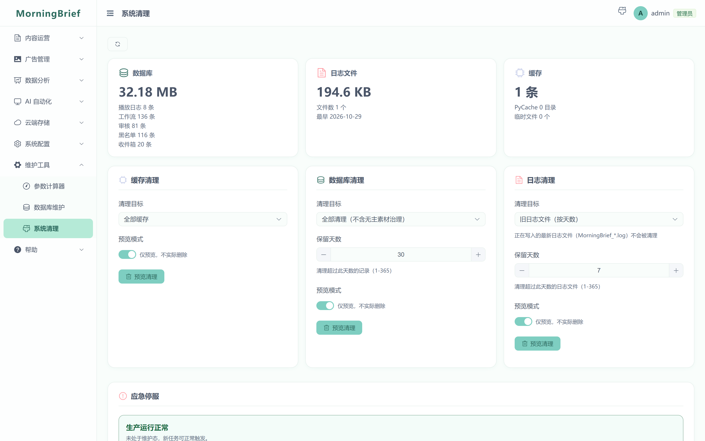

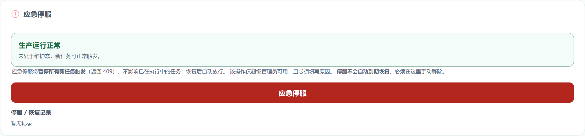

### 10. 观感与可访问性

后台内置 6 套主题，文字与提示元素的对比度按 WCAG AA 门禁校验；同一套运营能力另有移动端 H5 形态，手机上也能完成审核、发布与应急处置。

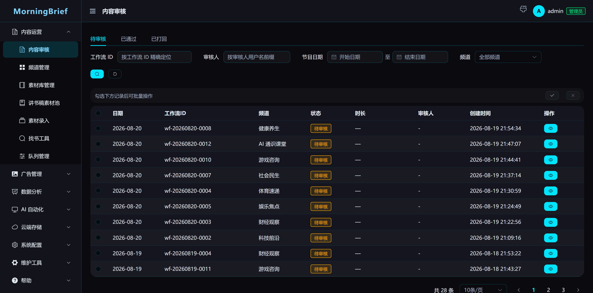

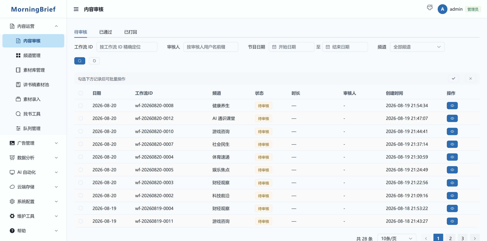

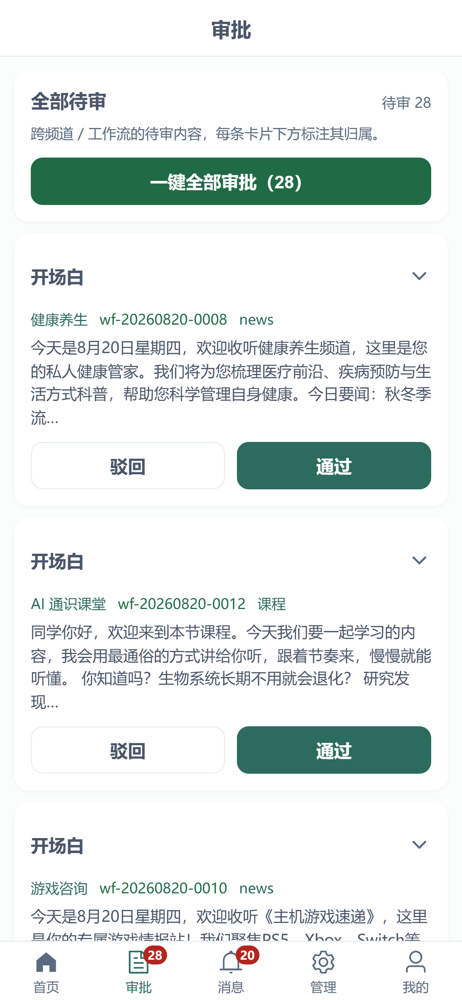

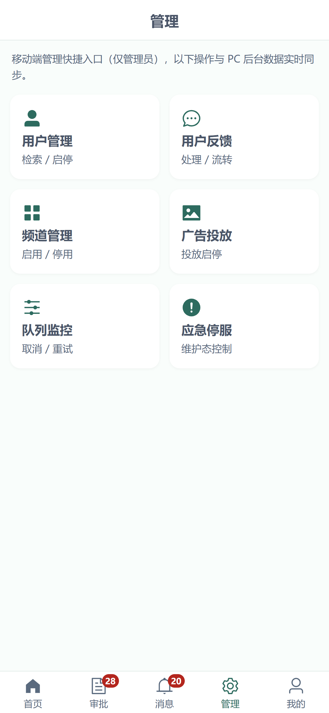

## 谁在用，什么时候用

**听众侧**（按需求规格说明书的用户画像）：通勤白领（约 50%，地铁公交上的碎片时间）、驾驶人群（约 20%，需要不分散注意力的获取方式）、中老年用户（约 20%，更适应「听」而非「读」）、内容消费者（约 10%，把节目当播客听）。

**生产侧**：栏目运营方 / 自媒体（每天固定时间自动出片，人工只做终审）、知识付费与教育内容团队（书单、教材、课程资料导入后转成章节化音频）、企业与机构内部资讯（行业动态与内部简报编排成每日一听，配合应急停服与审计能力满足内控要求）。

## 为什么这样设计

- **比自建录音团队轻**：产出一期节目的人力成本压缩到「审核 + 点击发布」。
- **比通用朗读工具深**：节目结构、音色搭配、广告排期、审核合规是一体设计的，不是拼三个工具。
- **比云端 SaaS 更可控**：单 exe 私有化部署，素材、稿件、音频与用户数据都留在自己机器上；对外分发只暴露小程序接口。
- **比黑盒方案更可查**：每个流程节点的状态、每次后台操作留下的审计记录、每个统计指标的单位口径都能当场追问到底。

## 听众端闭环（小程序）

小程序覆盖收听产品的完整一圈：首页与播放页（后台播放、锁屏控制、倍速、断点续播）、播放队列、下载与收藏、历史与最近播放、搜索、订阅与偏好设置、反馈入口，以及隐私授权与「删除我的数据」。

> 小程序侧界面截图需要微信开发者工具环境，尚未出图（工单 T03644）；此处不放占位图。

## 合规要点

- **接口合规**：微信小程序要求公网 HTTPS 合法域名，C 端接口由云函数承接，生产与后台留在本机。
- **内容合规**：节目按分级要求附带提示语，敏感词与内容安全检测在合成前执行。
- **隐私合规**：小程序启用隐私授权检查，用户可自助删除个人数据，删除范围与留痕口径经过正式裁决并有审计记录。
- **操作合规**：危险操作统一二次确认，后台动作写入审计日志，密钥类字段默认脱敏。

> 以上产品段落与 `docs/产品介绍/MorningBrief-产品介绍.md`（对外产品介绍源稿，Word 由它编译）同源：
> 数字与功能描述改一处需同步另一处，配图另存放在 `docs/产品介绍/assets/`。

## 特性

上面的「核心功能与界面」按模块看图，这里按能力面速览（与代码一一对应）：

- **全流程内容工作流**：爬虫抓取 → LLM 改写 → TTS 合成 → ffmpeg 拼接/BGM → 人工审核 → 发布，各阶段状态可追踪、可重跑。
- **5 个 TTS 引擎可插拔**：阿里云 NLS / 腾讯云 / Edge-TTS（免费）/ Kokoro / Piper（本地离线），统一 Provider 抽象，随时切换。
- **交叉音色**：稿件分段轮流换声（轮流/随机/间隔策略），避免单一音色同质化；音色列表支持一键从官方接口同步。
- **跨端交付**：Vue 3 管理后台（Element Plus）+ 微信小程序（收听/订阅/下载/课程学习）+ 云函数。
- **单机零运维**：SQLite（WAL）+ TTLCache 进程内缓存替代 MySQL/Redis，全局写序列化，单 worker 即可稳定运行。
- **合规与安全**：内容分级提示（disclaimer）、敏感词内容安全、管理员审计日志、小程序隐私授权（`__usePrivacyCheck__`）。
- **工程化**：pytest 全量回归（1694 个用例）、管理后台 / 小程序 `node:test` 单测、Playwright e2e、JMeter 压测、SonarQube 接入、GitHub Actions CI。

## 架构

```
┌────────────────────────────┐
│  内容工作流（backend/app/workflow）   │
│  crawler → rewrite → tts → stitch │
│           → review → publish      │
└─────────────┬──────────────┘
              │
┌─────────────▼──────────────┐        ┌─────────────────────┐
│  FastAPI (app.main:app)    │        │  apps/admin-web     │
│  ├ /api/v1        C 端 API  │◄──────►│  Vue 3 管理后台      │
│  ├ /admin/api/v1  B 端 API  │        │  (Element Plus)     │
│  ├ /api/internal 工作流触发  │        └─────────────────────┘
│  └ /api/health    健康检查   │        ┌─────────────────────┐
│                            │◄──────►│  apps/miniprogram   │
│  SQLite(WAL) + TTLCache    │        │  微信小程序           │
└────────────────────────────┘        └─────────────────────┘
```

## 技术栈

| 层 | 选型 |
| --- | --- |
| 后端 | Python 3.12 · FastAPI 0.110 · Uvicorn · SQLAlchemy 2.0（async）· Pydantic Settings · APScheduler |
| 数据与缓存 | SQLite（WAL，aiosqlite）+ cachetools TTLCache，全局写序列化（`app/core/write_gate.py`）替代 MySQL / Redis |
| 内容生产 | httpx + feedparser + selectolax 抓取 · OpenAI 兼容协议接 LLM · 5 引擎 TTS · ffmpeg 拼接混音 · jieba + pyahocorasick 敏感词 |
| 管理后台 | Vue 3.4 · Element Plus 2.14 · Pinia · Vue Router 4 · Vite 5 · Chart.js |
| 小程序 | 微信小程序原生（基础库 3.3.4）+ 腾讯云函数（`apps/scf`） |
| 交付与质量 | PyInstaller 单 exe + Inno Setup · GitHub Actions CI · pytest 8 · node:test · Playwright 1.61（e2e）· JMeter 5.6.3（压测）· SonarQube |

## 安装

### 后端（Python 3.12）

```bash
cd backend
python -m venv .venv
.venv\Scripts\activate            # Windows；macOS/Linux 用 source .venv/bin/activate
pip install -r requirements.txt
# 可选：额外 TTS 引擎依赖（Kokoro / Piper 本地引擎）
pip install -r requirements-tts-extra.txt
```

### 管理后台（Node.js）

```bash
cd apps/admin-web
npm install
npm run dev        # 开发模式，Vite 本地服务
npm run lint       # ESLint（no-undef + import/no-unresolved），已挂在 build 前置
npm run build      # 生产构建，base=/news/（先跑 lint，红了不出包）
```

### 微信小程序

用微信开发者工具导入 `apps/miniprogram/` 目录即可（基础库 3.3.4）。
图标源稿在 `apps/miniprogram/images/svg-src/`，改 SVG 后运行：

```bash
cd apps/miniprogram/images/svg-src && npm install && node convert-icons.js
```

## 快速开始

```bash
# 1. 配置环境变量（数据库、TTS、LLM 等均有注释说明）
cp backend/.env.example backend/.env

# 2. 创建管理员账号
cd backend && .venv\Scripts\python seed_admin.py

# 3. 启动后端（默认单 worker；写锁/缓存为进程内状态，多 worker 需按角色拆分，见 backend/launcher.py）
.venv\Scripts\python -m uvicorn app.main:app --workers 1
# 需要多进程扛读量时改用 launcher（自动编排 1 个 sched + N 个 api，.env 设 UVICORN_WORKERS=2）
.venv\Scripts\python launcher.py

# 4. 打开管理后台
cd apps/admin-web && npm run dev
```

或直接使用仓库脚本：`scripts/start.ps1`（启动）/ `scripts/stop.ps1`（停止）。

## 配置

所有配置集中在 `backend/.env`（见 `.env.example` 内注释），启动时由
`ai_config` 表覆盖 `Settings` 单例，管理后台修改后**热更新**、无需重启：

| 分组 | 关键项 |
| --- | --- |
| 数据库 | `SQLITE_DB_PATH`、`SQLITE_JOURNAL_MODE=WAL`、`SQLITE_BUSY_TIMEOUT_MS` |
| LLM | `LLM_BASE_URL` / `LLM_API_KEY` / `LLM_MODEL`（OpenAI 兼容协议） |
| TTS | `TTS_PROVIDER`（aliyun/edge/tencent/kokoro/piper）+ 各引擎凭证 |
| 交叉音色 | `BGM_GAP_MODE`（continuous/silence/bridge）、`SEGMENT_CROSSFADE_SEC` |
| 云存储 | `COS_SECRET_ID/KEY/BUCKET`（可选，启用后小程序头像直传 COS） |

> 注意：`.env` 中「仅作说明的空值项」注释必须独立成行，不要写 `KEY= # 注释`
> （pydantic-settings 未开启行内注释剥离，会把注释文本当成值）。

## API

统一前缀与响应格式 `{ code, message, data }`：

| 前缀 | 用途 |
| --- | --- |
| `/api/v1/*` | C 端（小程序）：频道/节目/播放/收藏/队列/评论/下载 |
| `/admin/api/v1/*` | B 端（管理后台）：内容工作流、频道、AI 服务配置、审核、统计、云端存储 |
| `/api/internal/workflow` | 工作流内部触发 |
| `/api/health` | 健康检查 |

## 部署

支持打包为**单 exe**（内嵌 SQLite + 管理后台静态资源），单机零运维：

```powershell
scripts/build-frontend.ps1   # 构建管理后台 SPA
scripts/build-exe.ps1        # PyInstaller 打包 + Inno Setup 安装包
```

产物（版本号取自 `backend/VERSION`）：

| 路径 | 说明 |
| --- | --- |
| `release/MorningBrief/MorningBrief.exe` | PyInstaller COLLECT 目录，同目录含 `.env`、`admin-web/dist/`、`data/`、`logs/` |
| `release/MorningBrief-Setup-v<版本>.exe` | Inno Setup 安装包，由 `installer.iss` 定义 |

## 测试

```bash
# 后端全量回归（1694 个用例，本地 Python 3.12）
cd backend && .venv\Scripts\python -m pytest tests/ -q

# 管理后台单元/契约测试（node --test，tests/unit/*.test.mjs）
cd apps/admin-web && npm run test:unit

# 小程序工具层单测
cd apps/miniprogram && node --test "tests/*.test.js"

# 性能压测（JMeter 5.6.3）
scripts/jmeter_test/

# 压测回归门禁：一条命令串起 清理→建用户/token→seed→固定档位压测→analyze→cleanup
# 退出码 0=达标 / 1=有档位破线（回归）/ 2=前置条件或工具链失败
cd scripts/jmeter_test && python perf_gate.py --tier quick      # ~4 分钟 3 档
python perf_gate.py --tier standard                             # 默认档（含管理端，需 GATE_ADMIN_TOKEN）
python perf_gate.py --tier full --update-baseline               # 全档位并重写延迟基线 gate_baseline.json
```

### 管理后台 e2e（Playwright）

```bash
cd apps/admin-web
npm run test:e2e        # 本地 e2e；浏览器前置自动检测，见下
npm run e2e:install     # 首次运行或缓存缺失时：下载 playwright 自带 chromium（约 150MB）
```

`playwright test` 启动时由 `scripts/e2e-browser-plan.mjs` 做浏览器前置判定，四态：

| 情况 | 行为 |
| --- | --- |
| 自带 chromium 缓存就绪 | 直接用，行为与从前一致 |
| `PW_CHANNEL=chrome`（或 `msedge`） | 显式指定，优先于一切探测 |
| 缓存缺失/版本与 `@playwright/test` 不匹配，本机有 Chrome/Edge | 非 CI 下自动回退系统浏览器，并打印一行提示 |
| 都没有（或 CI 上没装） | 前置直接报错中止，并给出 `npm run e2e:install` / `PW_CHANNEL=chrome` 两条修复命令 |

「版本不匹配」是常见坑：上游升级后缓存里是 `chromium-1248`、而 lockfile 里的
`@playwright/test` 只认 `chromium-1228` 时，playwright 自己只会报
`Executable doesn't exist at ...`，看不出该装还是该换——前置会把它归为缺失。

CI 刻意**不**自动回退：workflow 里必须先 `npx playwright install --with-deps chromium`
（见 `.github/workflows/ci.yml`），runner 上没有系统浏览器，静默回退只会把契约被破坏伪装成绿灯。
Windows PowerShell 里显式指定渠道为 `$env:PW_CHANNEL="chrome"; npm run test:e2e`。

## 目录结构

```
├── apps/                 # 前端：admin-web（Vue 3 后台）/ miniprogram（微信小程序）/ scf（云函数）
├── backend/              # FastAPI 服务（app/ + tests/ + data/ + ffmpeg/）
│   └── app/workflow/     #   内容生产流水线（含 tts/ 五引擎、stitch/ 拼接）
├── docs/                 # 文档与设计源稿（assets-src/ 为社交预览图源文件；
│   │                     #   assets/product-intro/ 为本 README 功能截图，随源码入库）
│   └── 产品介绍/          #   对外产品介绍 Markdown 源稿 + build_docx.py（Word 由源稿编译生成）
├── release/              # 构建产物：MorningBrief/（PyInstaller 目录）、MorningBrief-Setup-v*.exe、assets/
├── runtime/              # 运行时：内网穿透二进制、日志
├── scripts/              # 构建 / 启停 / 压测 / 发布脚本
├── MorningBrief.spec     # PyInstaller 打包配置
├── installer.iss         # Inno Setup 安装包脚本
└── .github/workflows/    # CI 流水线（后端测试 / 前端构建+e2e / 小程序门禁 / 打包验证）
```

## 贡献指南

1. Fork 仓库并从 `main` 切出分支，分支名建议带票号（如 `feat/T03626-readme-sync`）。
2. 改动后跑通对应侧回归（见「测试」）：后端 `pytest tests/ -q`、管理后台 `npm run test:unit`、小程序 `node --test "tests/*.test.js"`；动到界面再跑 `npm run test:e2e`。
3. 提交信息沿用仓库格式 `<type>(<票号>): <摘要>`，例如 `fix(T03603): 导入失败行只计一次`。
4. 提 PR 时写清动机与验证方式；涉及配置项同步更新 `backend/.env.example`，涉及界面措辞同步更新对应的构建期门禁断言。
5. 不要把 `.env`、真实 API Key、`backend/data/` 下的数据库带进提交。

PR 需通过 `backend-test`、`frontend-build-test`、`miniprogram-check` 三个 CI job；push 到 `main` 时还会额外跑 `pyinstaller-build` 打包验证（见 `.github/workflows/ci.yml`）。

## 致谢

- [edge-tts](https://github.com/rany2/edge-tts) —— 免费 Edge/Azure 神经网络语音
- [Tabler Icons](https://tabler.io/icons)（MIT）—— 全站图标
- [Element Plus](https://element-plus.org/)、[resvg-js](https://github.com/thx/resvg-js)

## 风险免责

本项目仅供**个人研究与学习**使用，部署与使用时请知悉：

- **内容版权**：抓取的内容来自公开 RSS 与第三方来源，版权归原作者所有；请遵守来源站点
  的服务条款与抓取约定，勿将抓取内容用于商业再分发。
- **AI 生成内容**：LLM 改写与 TTS 合成的稿件可能存在事实性错误或幻觉，**发布前必须经过
  人工审核**（工作流已内置审核环节）；本项目不对自动生成内容的准确性、完整性作任何担保。
- **第三方服务**：LLM / TTS / 对象存储等外部服务的使用请遵守对应服务商的条款与计费规则；
  请妥善保管 API Key，勿将 `.env` 与真实凭证提交到仓库。
- **合规使用**：请遵守所在地区关于内容传播、数据抓取与个人信息保护的法律法规。

