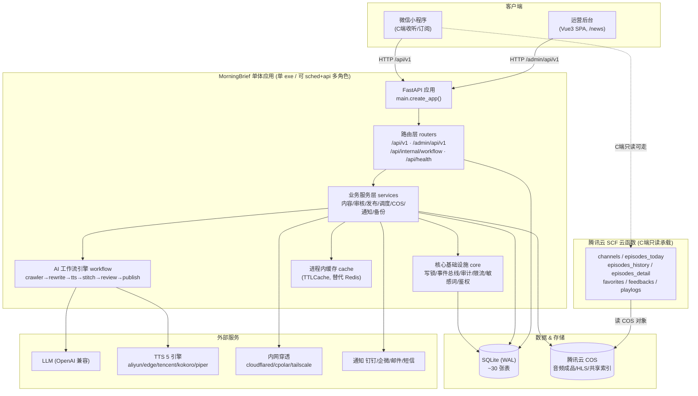
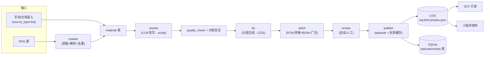
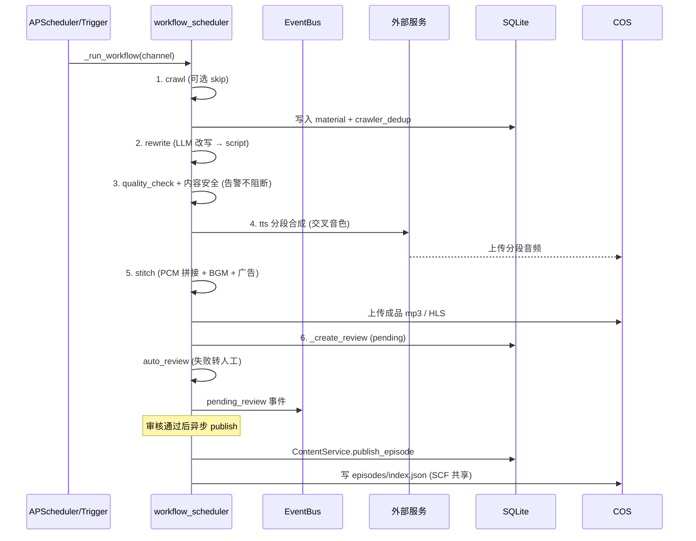
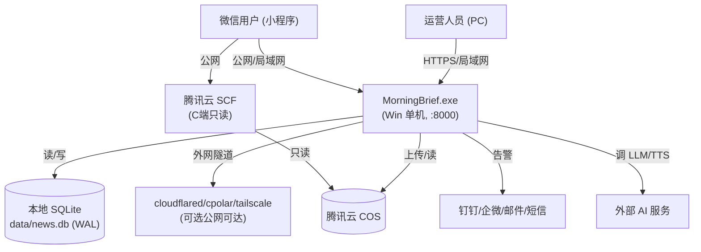

# 系统架构设计文档（MorningBrief / 20_News）

> 本文档基于 `D:/code/otherProjects/20_News` 工作空间内**当前源代码实现**编写，所有架构描述均可在代码中核实，无虚构组件。
> 配套详细设计请参阅仓库内 `docs/概要设计说明书.md`、`docs/详细设计说明书.md` 及各需求规格说明书；本文档定位为**高层架构总览**。
> 编写时间：2026-11-02；代码基线：commit `ad56ba2` 之后。

---

## 1. 引言与系统概述

### 1.1 业务背景

MorningBrief（仓库名 `20_News`）是一套把「新闻资讯 / 专业资料」自动转化为**可订阅语音节目**的完整内容生产系统。其本质是「**内容生产流水线 + 媒体播放产品**」：以频道（`Channel`）为内容配方容器，将抓取、AI 改写、语音合成、拼接混音、人工审核、定时发布等环节串联为可追踪、可重跑的工作流，最终通过运营后台与微信小程序交付给用户收听。

### 1.2 核心目标

- **全链路自动化**：抓取 → LLM 改写 → TTS 合成 → 拼接混音 → 审核 → 发布，各阶段状态可追踪、可重跑。
- **单机零运维**：以单个 Windows exe + 内置 SQLite + 进程内缓存的形式交付，无需 MySQL/Redis/外部消息队列。
- **多端交付**：Vue 3 运营后台（B 端）+ 微信小程序（C 端收听/订阅/下载）+ 腾讯云 SCF 云函数（C 端只读承载）。
- **可配置化扩展**：后端约 80% 能力业务无关，新业务域（如专业资料 → 语音学习）主要靠频道配方与输入适配器扩展，而非重写代码。

### 1.3 读者与范围

本文档面向架构评审、新成员上手与扩展评估。覆盖系统拓扑、模块职责、关键接口、数据流向、技术选型与部署形态；不展开单接口字段级契约（见各需求规格与 OpenAPI）。

---

## 2. 总体架构

### 2.1 架构理念

系统采用**单体应用 + 进程内调度 + AI 工作流**形态：

- 后端 FastAPI 应用、APScheduler 调度器、AI 工作流引擎全部运行在**同一个 exe 进程**内（默认 `workers=1`）。
- 数据持久化使用 **SQLite（WAL）+ 进程内 TTLCache**，刻意不引入 MySQL/Redis，以换取单机零运维。
- **C 端高可用解耦**：微信小程序的只读接口由独立的腾讯云 **SCF 云函数**承载，SCF 只读 COS 对象、不访问 SQLite；当单机 exe 离线时，C 端仍可读历史节目。

### 2.2 总体架构图

### 2.3 技术分层

| 层 | 组成 | 职责 |
|---|---|---|
| 接入层 | admin-web（Vue3 SPA）、微信小程序、SCF 云函数 | 人机交互与 C 端只读承载 |
| 应用层 | FastAPI（routers / services / workflow） | HTTP 路由、业务逻辑、AI 工作流编排 |
| 基础设施层 | SQLite + TTLCache、全局写锁、EventBus、限流、审计、敏感词、隧道 | 持久化、缓存、一致性、可观测、安全 |
| 外部服务层 | LLM、TTS、COS、内网穿透、通知网关、微信 | 能力外扩与触达 |

---

## 3. 模块详细设计

### 3.1 应用入口与生命周期

- **文件**：`backend/app/main.py`（`create_app()` 工厂）+ `backend/app/launcher.py`（exe 启动入口）。
- **生命周期（`lifespan`）**：建表/迁移/seed → 加载 `ai_config`/`cos_config` 覆盖 `Settings` → 启动 APScheduler、EventBus、`play_write_buffer`、内网穿透隧道。
- **中间件顺序**：`RequestIdMiddleware → RateLimitMiddleware → PathPrefixMiddleware`（后者剥离 `/news` 前缀，兼容单机与反向代理路径）。
- **SPA 托管**：`admin-web/dist` 以 `/` 与 `/news/` 双前缀挂载；音频/BGM/频道资产/头像用支持 Range 的 `CORSStaticFiles`。

### 3.2 路由层（`backend/app/routers/`）

统一响应格式 `{ code, message, data }`。前缀经源码核实：

| 前缀 | 用途 | 典型路由文件 |
|---|---|---|
| `GET /api/health`（`/live` `/ready`） | 健康检查 | `routers/health.py` |
| `/api/v1/*` | **C 端**（小程序） | `routers/api/`：auth/channels/episodes/favorites/subscriptions/playlogs/comments/feedbacks/cos/courses/account/client |
| `/admin/api/v1/*` | **B 端**（运营后台） | `routers/admin/`：auth/channels/materials/workflows/reviews/ai/cos/ads/stats/backup/audit/maintenance/auto_review/queue/notification/book_pool/ebooks/mobile/system/events/tunnel/about/users |
| `/api/internal/workflow` | 工作流内部触发（仅 localhost + 可选 token） | `routers/internal/workflow.py`（`verify_localhost` 依赖，支持 `X-Forwarded-For` 与 `X-Internal-Token` 双因素）：`POST /trigger`、`GET /{id}`、`POST /{id}/publish` |

### 3.3 业务服务层（`backend/app/services/`）

承载核心业务逻辑，关键模块：

- **`workflow_scheduler.py`**：工作流编排核心。`_run_workflow()` 顺序执行各步，每步 `_run_step()` 包裹重试（默认 3 次），经 `core/event_bus.py` 发布 `workflow.started / step.completed / step.failed / completed / pending_review / content_security.risky / quality_check.issues` 事件。由 APScheduler 按 `WORKFLOW_CRON_HOUR`（默认 5:00）触发，或 `/api/internal/workflow/trigger` 手动触发；内存队列（`QueueEntry` + `_trigger_lock`，`WORKFLOW_LOCK_TTL_SEC=1800`）。
- **`content_service.py` / `review_service.py` / `publish`**：内容、审核、发布。`ContentService.publish_episode` 创建 `episode` 并失效缓存。
- **`ai_config_service.py` / `cos_storage_service.py`**：AI 与 COS 配置；`apply_config_to_settings()` 在启动时把 `ai_config`/`cos_config` 表覆盖进 `Settings` 单例（热更新）。
- **`tunnel_service.py` + `tunnel_providers.py`**：cloudflared / cpolar / tailscale 三选一内网穿透，`auto_start` 由守护线程拉起。
- **`notifier/` + `notification/`**：钉钉/企微/邮件/短信通知（`factory.py`/`hub.py`）。
- 其他：备份（`backup_service`）、维护清理（`maintenance_service`）、自动审批（`auto_review_service`）、统计（`stats_service`）、TTS 模型管理、数据库管理（`db_admin_service`）等。

### 3.4 AI 工作流引擎（`backend/app/workflow/`）

分阶段流水线（详见第 5 节）。关键子包：

- **`crawler/`**：RSS 抓取（`rss_spider.py`）、正文解析（`article_parser.py`、`selectolax`）、AI 筛选（`_ai_fallback_filter`）、去重（`dedup.py` + `crawler_dedup` 表，`CRAWLER_DEDUP_TTL_DAYS=3`）。支持 `skip_crawl`（文档/手动选题从 rewrite 起）。
- **`llm/`**：`rewriter.py`（`rewrite()`，按 `TARGET_DURATION_SEC` 反算字数）+ `heat_score.py`（热度）+ `sensitive_filter.py`（AC 自动机敏感词）+ `style_library.py`。
- **`tts/`**：`tts_factory.py`（5 引擎注册表）+ `synthesizer.py`（`synthesize()`，信号量并发、预算/限速、tenacity 重试、`assign_cross_voices()` 交叉音色）+ 各 provider + `audio_postprocess.py` + `uploader.py`。
- **`stitch/`**：`concat.py` + `ffmpeg_wrapper.py`，PCM 中间态拼接混音（详见 5.4）。
- **`duration.py` / `text_clean.py`**：时长反算与文本清洗。

### 3.5 数据模型层（`backend/app/models/`）

SQLAlchemy ORM，**约 30 张表**。核心实体：

- 内容域：`Channel`（内容配方）、`Material`（素材/去重源）、`Script`（改写稿）、`Review`（审核）、`Episode`（成品节目）、`Workflow`/`WorkflowStep`（工作流实例与步骤）。
- 用户域：`User`、`AdminUser`、`Favorite`、`Comment`/`CommentLike`、`PlayLog`/`PlayProgress`、`Subscription`/`ChannelSubscription`。
- 运营域：`AdMaterial`/`AdPlacement`（广告）、`NotificationTemplate`/`NotificationLog`、`AuditLog`、`MaintenanceTask`。
- 配置域：`AIConfig`/`AIUsageLog`、`CosConfig`、`AutoReviewConfig`/`AutoReviewStat`、`QueueConfig`、`SystemFlag`、`BookPoolItem`。
- 安全域：`JwtBlacklist`（B 端本地；C 端黑名单存 COS 共享）、`CrawlerDedup`。

### 3.6 核心基础设施（`backend/app/core/`）

- **写串行化**：`write_gate.py` 进程内 `asyncio.Lock`（`serialized_write()` / `write_lock()`），仅串行化**写事务提交阶段**，读不受影响（WAL）。
- **事件总线**：`event_bus.py`（`EventBus`），解耦工作流与通知/审计。
- **安全/鉴权**：JWT 签发验签（`pyjwt`）、B/C 端 token 类型区分、TC3 签名（`core/tc3.py`）。
- **限流**：`rate_limit.py` + `slowapi`（B 端 `RATE_LIMIT_PER_MINUTE`）。
- **敏感词**：AC 自动机（`pyahocorasick`）+ SIMHASH 指纹。
- **审计/日志**：`audit.py`、`logging_setup.py`（loguru 滚动 + 目录总量兜底）。

### 3.7 缓存（`backend/app/cache/`）

`cachetools.TTLCache` 进程内缓存（默认 `maxsize=10000`、`ttl=300s`），**替代 Redis**；原子计数用 `asyncio.Lock` 模拟 INCR。原 Redis Bitmap/Set/List 语义改用 SQLite 表（如 `crawler_dedup`、`stats_service`）。

### 3.8 COS 存储（`backend/app/cos/`）

`cos/client.py` + `services/cos_storage_service.py`（`cos-python-sdk-v5`）。用途：

- 音频成品 / HLS 分片存储；
- **C 端 API 共享层**：`episodes/index.json`、节目详情、`jwt_blacklist/`（B/C 端黑名单共享）；
- UGC 头像预签名直传（`POST /api/v1/cos/presign-upload`）；
- 覆盖快照 `COS_BACKUP_KEEP_COUNT`。

### 3.9 前端与 C 端

- **运营后台 `apps/admin-web/`**：Vue 3.4 + Element Plus 2.14 + Vite 5（`base=/news`）+ Pinia + vue-router + axios + chart.js。经 `vite build` 产出 `dist/`，由后端 `StaticFiles` 直接托管。
- **微信小程序 `apps/miniprogram/`**：`app.js/json` + `pages/`（today/history/detail/channels/search/queue/profile/about）+ `components/`（audio-player、floating-player、episode-card）+ `services/`（auth/request）。`wx.login` 换 token 后调 `/api/v1/*`；播放器用 `BackgroundAudioManager`（HLS 走分片，主用 mp3）。
- **云函数 `apps/scf/`**：承载 C 端只读接口，与单机 exe 解耦——只读 COS、不访问 SQLite，`handler_base.py` 共用 COS 客户端 + JWT 验签 + 统一响应。函数目录：channels / episodes_today / episodes_history / episodes_detail / favorites / feedbacks / playlogs。

---

## 4. 数据架构

### 4.1 持久化与连接

- **ORM**：SQLAlchemy 2.0.25 **async**（`sqlalchemy[asyncio]`）+ `aiosqlite 0.19.0` 驱动，`database.py` 暴露 `Base`/`engine`/`AsyncSessionLocal`/`get_db`。
- **数据库**：SQLite（`sqlite+aiosqlite:///`），**WAL 模式**，`busy_timeout=10000ms`，synchronous `NORMAL`。
- **连接池**：`AsyncAdaptedQueuePool`（`SQLITE_POOL_SIZE=20`、`SQLITE_MAX_OVERFLOW=100`、`SQLITE_POOL_ENABLED`），消除每请求建连开销。
- **迁移**：**不安装 `alembic`，仓库内也无 `alembic.ini` / `migrations/`**（T04091 已将依赖移除）；schema 迁移靠 `Base.metadata.create_all` + 大量内联 `PRAGMA`/`ALTER TABLE`/`CREATE INDEX`/`CREATE VIRTUAL TABLE`（FTS5）函数，在 `lifespan` 中以幂等方式运行（如 `_migrate_channel_schema`、`_migrate_hls_url_columns`、`_migrate_fts5_index`）。

### 4.2 缓存策略

- 进程内 `TTLCache` 替代 Redis：热点读（频道列表、节目索引）缓存；写后按 key 失效（如 `publish_episode` 失效节目缓存）。
- 跨进程无效：多 worker 时各进程缓存独立，因此 `workers>1` 仅适合纯读或切共享态（MySQL+Redis）。

### 4.3 写串行化边界（重要）

`core/write_gate.py` 的 `asyncio.Lock` **仅进程内有效**：

- 只串行化写事务提交，读不受限（WAL 多版本）；
- **不提供跨进程互斥**；`workers>1` 或同库多进程时无效；每个进程各自一份锁。
- 因此官方约束：**默认单 worker**；多 worker 仅用于纯读或切外部共享存储。

### 4.4 配置运行时覆盖

`models/ai_config.py` 与 `cos_config` 表在 `lifespan` 启动阶段经 `AIConfigService.apply_config_to_settings()` / `CosConfigService.apply_config_to_settings()` 把值 `setattr` 进 `Settings` 单例（经 `CONFIG_KEY_MAP` 映射），覆盖 `.env` 默认值——即运营后台「AI 配置页」「COS 配置页」热改即时生效，无需重启。

### 4.5 数据流向图

---

## 5. 内容工作流数据流（核心链路）

### 5.1 流水线

### 5.2 各阶段要点

| 阶段 | 输入 | 输出 | 关键文件 | 说明 |
|---|---|---|---|---|
| crawl | RSS / 手动素材 | `material` 行 | `crawler/runner.py`、`rss_spider.py`、`dedup.py` | 正文解析 `selectolax`；AI 筛选；`CRAWLER_DEDUP_TTL_DAYS=3` |
| rewrite | `material` | `script` 行 | `llm/rewriter.py` | 按 `TARGET_DURATION_SEC` 反算字数；频道级 `rewrite_template` 覆盖 |
| quality_check / 内容安全 | `script` | 质量/安全报告 | `scheduler._run_content_security_check` | 微信 `msg_sec_check`；告警不阻断 |
| tts | `script` 分段 | 分段音频 URL | `tts/synthesizer.py`、`tts_factory.py` | 信号量并发、预算/限速、tenacity 重试、交叉音色 |
| stitch | 分段音频 | 成品音频 | `stitch/concat.py`、`ffmpeg_wrapper.py` | PCM 中间态，见 5.4 |
| review | 成品 | `review` 行 | `review_service.py`、`auto_review_service.py` | 自动审批失败转人工 |
| publish | 审核通过 | `episode` + 缓存失效 | `ContentService.publish_episode` | 写 COS 共享索引 |

### 5.3 TTS 引擎（5 个，可插拔）

经 `workflow/tts/tts_factory.py` 注册表 `_PROVIDER_REGISTRY`：`aliyun`（NLS）、`edge`（微软 Edge-TTS 免费）、`tencent`（腾讯云，凭证可回退 COS）、`kokoro`（Apache 2.0 本地离线）、`piper`（MIT 本地离线）。`TTS_PROVIDER` 可由 `ai_config` 表热切换；`get_tts_provider()` 带单例缓存，`invalidate()` 热重载。**交叉音色** `assign_cross_voices()` 支持段落间轮换（piper 单说话人不生效）。

### 5.4 拼接混音（关键设计）

- **PCM 中间态**：所有分段/广告先 `to_pcm` 解码为 16bit WAV，拼接/混音/插广告/变速均在 PCM 上完成，**整期只在最后编码一次 MP3**（HLS 从同一 PCM 编 AAC），避免多代有损。
- **段间模式**（`BGM_GAP_MODE`，全局或频道级）：`continuous`（默认，crossfade 交叉淡化）、`silence`（插静音）、`bridge`（BGM 桥接）。
- **广告插入**：`AdService.get_active_placements(episode_date)` 按 head/mid(300s)/tail 三位置插入；课程频道 `enable_ad=0` 跳过。
- **时长兜底**：目标 `[target×0.80, target×1.20]`（绝对下限 180s）；超长 ≤1.15x 用 `atempo` 加速，不足优先用 BGM 尾段补足（无 BGM 降级静音），落 `original_duration`/`supplement_sec` 留痕。
- **COS 上传 key**：`episodes/{YYYYMMDD}/{channel_slug}_{workflow_id}.mp3`；`HLS_ENABLE` 时生成 m3u8+ts（失败仅告警，回退 mp3）。FFmpeg 缺失时由 `FFMPEG_DOWNLOAD_URL` 自动下载。

---

## 6. 技术选型

### 6.1 后端技术栈

| 类别 | 技术 | 版本 | 作用 |
|---|---|---|---|
| Web 框架 | FastAPI / uvicorn[standard] | 0.110.0 / 0.27.0 | HTTP API、ASGI 服务 |
| 异步 ORM | SQLAlchemy[asyncio] / aiosqlite | 2.0.25 / 0.19.0 | SQLite 异步访问 |
| 迁移 | create_all + 内联 ALTER/PRAGMA | — | 启动期幂等执行；**alembic 已移除**（无脚手架，T04091） |
| 缓存 | cachetools (TTLCache) | 5.3.3 | 进程内缓存，替代 Redis |
| 鉴权 | pyjwt / bcrypt | 2.8.0 / 4.1.2 | JWT 签发验签、密码哈希 |
| LLM | openai（OpenAI 兼容） | 1.12.0 | 通义千问等模型调用 |
| 重试 | tenacity | 8.2.3 | 工作流/外部调用重试 |
| TTS | edge-tts | 7.3.1 | 免费微软神经语音（须 ≥7.3.1） |
| 文档解析 | PyMuPDF | 1.28.2 | PDF 解析（扩展场景） |
| HTTP 客户端 | httpx | 0.27.0 | 内部/外部请求 |
| 抓取解析 | feedparser / selectolax | 6.0.11 / 0.4.10 | RSS 与正文提取 |
| 中文处理 | jieba / pyahocorasick | 0.42.1 / 2.3.1 | 分词、敏感词 AC 自动机 |
| 对象存储 | cos-python-sdk-v5 | 1.9.30 | 腾讯云 COS |
| 配置 | pydantic-settings / python-dotenv | 2.1.0 / 1.0.1 | 环境变量配置 |
| 调度 | apscheduler | 3.10.4 | 工作流定时触发 |
| 日志 | loguru / colorama | 0.7.2 / 0.4.6 | 滚动日志 |
| 限流 | slowapi | 0.1.9 | B 端速率限制 |
| 测试 | pytest / pytest-asyncio | 8.4.2 / 0.24.0 | 后端回归 |

### 6.2 前端技术栈

| 类别 | 技术 | 版本 | 作用 |
|---|---|---|---|
| 框架 | Vue / vue-router / pinia | ^3.4 / ^4.3 / ^2.1 | 运营后台 SPA |
| UI | Element Plus / @element-plus/icons-vue | ^2.14.2 / ^2.3.0 | 组件库 |
| 请求 | axios | ^1.6.0 | HTTP 客户端 |
| 图表 | chart.js / vue-chartjs | ^4.4.0 / ^5.3.0 | 统计可视化 |
| 构建 | Vite / @vitejs/plugin-vue / sass | ^5.2 / ^5.0 / ^1.72 | 打包（base=/news） |
| 质量 | @playwright/test / eslint | ^1.61.1 / ^9.39.4 | e2e 与静态检查 |

### 6.3 第三方服务

| 服务 | 用途 | 配置组 |
|---|---|---|
| LLM（OpenAI 兼容，默认通义千问） | 改写/审核/问答 | `LLM_*`、`ai_config` |
| TTS 5 引擎 | 语音合成 | `TTS_PROVIDER`、`ALIYUN_*`、`EDGE_*`、`TENCENT_*`、`KOKORO_*`、`PIPER_*` |
| 图像生成（agnes-image） | 频道封面/图标 | `IMAGE_API_*` |
| 腾讯云 COS | 音频/HLS/共享索引/直传 | `COS_*`、`cos_config` |
| 内网穿透 | 外网可达 | `TUNNEL_*` |
| 通知网关 | 钉钉/企微/邮件/短信 | `ALERT_*` |
| 微信 | 小程序登录/内容安全 | `WX_*` |

### 6.4 关键设计取舍

- **进程内 SQLite + TTLCache，不引 MySQL/Redis**：换取单机零运维；代价是写吞吐天花板（单写者串行 ~15–26 req/s）与多租户需另立项（P2）。
- **PyInstaller onedir + Inno Setup 单安装包**（非 onefile 单可执行体）：exe + `_internal/` 依赖文件夹，再由 Inno 打包成单个安装 exe。
- **C 端只读走 SCF + COS 解耦**：exe 离线时 C 端历史节目仍可读，提升可用性。
- **PCM 中间态单次编码**：保证音频质量，避免多代有损。

---

## 7. 部署与运维架构

### 7.1 打包与交付

- **`MorningBrief.spec`**（PyInstaller）：onedir 模式，入口 `backend/launcher.py`，输出 `release/MorningBrief/`（含 `MorningBrief.exe` + `_internal/`）。
- **`backend/launcher.py`**：定位 exe 同目录 `.env`，将 `_internal` 加入 `sys.path`，`uvicorn.run("app.main:app")`。**多角色编排**（`APP_ROLE`）：`workers>1` 时拆为 1 个 `sched` 进程（建表/迁移/seed、APScheduler、启动清理、隧道 auto_start）+ N 个 `api` 进程（纯 HTTP）；`sched` 用内部端口（业务端口+1），等 `/api/health` 就绪后再起 api，失败回退单进程 `all`。默认 `workers=1`。
- **`installer.iss`**（Inno Setup 6）：x64、管理员权限、`DefaultDirName={autopf}\MorningBrief`；`[InstallDelete]` 升级时整目录删 `admin-web` 防旧 chunk 残留；产物 `release/MorningBrief-Setup-v<version>.exe`。
- **构建脚本**：`scripts/build-exe.ps1`（venv→依赖→`build-frontend.ps1`→生成 `_build_info.py`/图标→PyInstaller→复制 `.env`/SPA/`data`/BGM/频道资产/seed→Inno 安装包）。

### 7.2 网络拓扑

### 7.3 运维能力

- **日志**：loguru 滚动（单文件 10MB + 跨日）+ `LOG_RETENTION_DAYS` + 目录总量 `LOG_DIR_MAX_MB` 兜底。
- **备份/恢复**：`backup_service` 生成快照与回滚点；覆盖快照存 COS。
- **系统清理/维护**：`maintenance_service`、`cleanup-config.yaml`（隔离区 + 保留根）。
- **审计**：`AuditLog` + 审计读口权限治理。
- **限流 / AI 预算**：`slowapi` 速率限制 + `core/ai_budget.py` 每日 token/费用/速率预算。
- **敏感内容**：AC 自动机敏感词 + 微信 `msg_sec_check` 内容安全。

### 7.4 测试与质量

- **pytest**（后端 `backend/tests/`，60+ 测试文件）：覆盖 ai_config、cos、workflow、audio_profile、auto_review、backup、book_pool 等。
- **Playwright e2e**（`apps/admin-web/tests/*.spec.js`）+ 前端 `tests/unit/*.test.mjs`。
- **JMeter**（`scripts/jmeter_test/`）：baseline / soak / 读取压力场景。
- **SonarQube**（`sonar-project.properties`）：当前仅扫后端 Python（`sonar.python.version=3.12`），前端因 Node 版本与 SonarJS bridge 不兼容暂未扫。
- **CI**：`.github/workflows/ci.yml`（Python 3.12，pytest）。

### 7.5 容器化说明

**仓库内无 Dockerfile / Kubernetes 配置**。当前部署形态为：Windows 单机 exe + 腾讯云 SCF（C 端只读）+ COS（共享存储）。如需容器化，需在外层引入 MySQL/Redis 以替代进程内状态（与现有单 worker 约束冲突，属架构升级项）。

---

## 8. 一致性说明与已知边界

为确保文档与代码一致，列明易误判点：

1. **Alembic 已移除**（T04091）：此前依赖清单含 `alembic` 却无迁移脚本，`python -m alembic current` 直接报 `No config file 'alembic.ini' found`；现依赖清单与「关于」页开源清单均已剔除，迁移完全依赖 `create_all` + 内联 PRAGMA/ALTER。将来若需要版本化迁移，须连同 `alembic.ini` + `migrations/` 脚手架一起引入。
2. **Python 版本已统一 3.12**（T04090）：CI 两个 job（`backend-test` / `pyinstaller-build`）、Sonar（`sonar.python.version`）、本地构建（`scripts/build-exe.ps1` 固定 3.12）与运行 `.venv`（3.12.13）全部为 3.12。唯一例外是 SCF 云函数运行时 `Python3.9`：那是云平台侧的部署事实，升级须在腾讯云控制台/CLI 改运行时并重部署；源码本身在 3.9 与 3.12 下语法均兼容（`ast.parse(..., feature_version=(3, 9))` 校验 17 个文件全部通过），故升级不需要改代码（升级事项：T04098）。
3. **全局写锁仅进程内有效**：跨进程/多 worker 无效，多写者需外部共享存储。
4. **「单 exe 交付」非 onefile**：实为 PyInstaller onedir + Inno 单安装包；C 端高可用依赖 SCF + COS，非 exe 自身。
5. **SCF 函数数**：源码 7 个目录（含 feedbacks/playlogs 写类），env 注释称「5 个核心只读接口承载层」，措辞差异已按源码如实描述。
6. **配置热更新边界**：`ai_config`/`cos_config` 表覆盖 `Settings` 单例，但进程内缓存（TTLCache）与写锁为各进程独立状态，多 worker 下需另行处理。

---

> 本文档所有模块、前缀、版本与数据流均基于 `backend/app/`、`apps/`、`requirements.txt`、`package.json`、`MorningBrief.spec`、`installer.iss` 等源码核实，可作为系统架构评审与扩展评估的权威总览。
